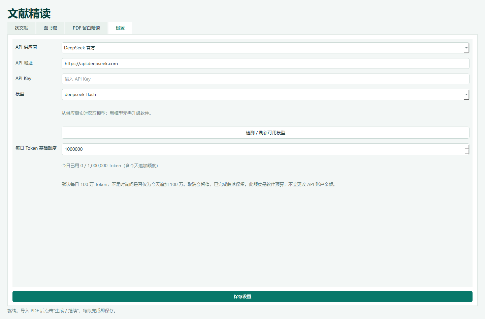

# 文献精读 · MoltenDaily 1.3.1

Windows 原生 EXE，固定浅色 / 深绿色。按“找文献 → 图书馆 → PDF 留白精读”组织操作，全局 API 与额度位于设置。

## 使用

1. 解压 Windows x64 便携包，运行 MoltenDaily.exe。无需安装 Python。
2. 在设置选择供应商并填写自己的 API Key，自动检测当前可用模型，再选择模型；也可手动刷新列表或输入模型 ID。旧版用户把新版 EXE 放回原目录，保留 userdata。
3. 找论文：输入中文或英文研究方向，点击“按此方向查询”。可手动填写英文检索词；留空时由 API 生成。
4. 图书馆：导入 PDF（支持批量），按需编辑标题、作者、年份、期刊和 DOI，创建分类归档。检索题录可直接获取开放 PDF，或关联已下载的文件。没有可用 PDF 时阅读按钮置灰。
5. 读论文：选中已关联文献，点击“阅读 PDF”，再点击“生成 / 继续留白精读”。完成后直接在软件内预览或导出；返回图书馆可定位当前论文。
6. 用加减按钮、百分比、适合宽度或 Ctrl + 滚轮缩放，支持 25%–400%。关闭窗口即退出，不再后台定时推送。

## 留白精读与续做

中央保留原 PDF 图文和公式。左边按原文块编号给出整段中文，右边给出编号专业词（IPA 与语境释义）、短语和长难句的完整翻译。每段优先选取最多 20 个专业词、6 个短语、2 个长难句，同页重复词去重；不为凑数标注人名、地址或无关普通词。页边不足时重复原页续排，保持字号。

每完成一个文本块就保存，暂停、关闭重开或调整额度后继续未完成部分；更换 API、模型或研究方向不会清空已完成的留白精读缓存。各段记录实际使用的模型。旧版可验证的译文与批注尽量复用，缺少整段译文的旧批注需要补译。

默认每日基础额度 **1,000,000 Token**，设置可调整至 100,000,000。旧版低额度首次升级自动提高一次。预计下一请求会超额时，软件询问是否仅为当天追加至少 1,000,000 Token；选择否则暂停并保留进度。次日追加额度归零。这个额度是本地调用预算，不是服务商账户余额，也不是精确计费预测。



## 搜索与限制

- 题录来自 Crossref / OpenAlex；AI 根据实际题目和摘要判断相关性，不生成虚构 DOI。自定义方向不限于熔盐。
- JIF 按年份与来源筛选，篇幅短者优先。内置 JIF 表只覆盖 3 本期刊的 2024 年指标，可导入 CSV；缺失、年份不符、数值不超过阈值或同一期刊存在冲突数据的记录不进入找文献结果。界面展示数值、年份、核对日期和来源。CSV 是人工维护的数据，不是实时全量 JCR 接口；导入方需保证来源和数值真实。
- 本版需要有文本层的 PDF，扫描件 OCR 不支持。图内文字和复杂公式保留原文；不能声称 AI 译文和音标零误差。
- 原文块对应不等于逐行排版一致。长块拆分后仍保留来源编号；参考文献等元数据可保持原文形式。
- 密钥用 Windows DPAPI 加密，本地保存；受限环境可能使用本机绑定。不要分享 userdata。API 会收到待处理原文文字，密钥不会加入 PDF 或公开源码。
- 关闭“只看符合筛选条件”也不能绕过 JIF 和日期硬性门槛。所有本地资料在图书馆管理。按需查询重复运行仍会显示已找到的符合条件文献。

## 题录文件导出

图书馆支持导出 RIS 和 EndNote Tagged（ENW）：选择一篇导出单篇，Ctrl / Shift 多选后批量导出，未选中时导出当前分类中可见的全部文献。文件可导入 EndNote、Zotero 等引用管理器。导出只保存文件，不打开外部软件，也不修改 Word 文档。

保留完整作者、卷期、页码 / 文章号和 DOI；缺失字段写入备注，不由模型补造。附件使用本机路径，不自动打包 PDF；另支持导入既有 RIS / EndNote XML。

## 供应商与模型

- 提供 DeepSeek 官方、硅基流动和自定义兼容接口。自定义接口需支持 GET /models 和 POST /chat/completions。
- 首次填写密钥后、切换到已配置供应商后、进入设置时自动查询模型。点击“检测 / 刷新可用模型”可重新获取新发布的模型。
- 模型列表来自服务端，不是写死在软件中的白名单。列表可见不等于每个模型都支持文本对话和 JSON 输出；仍需选用具有相应能力与权限的模型。
- 密钥与选择的模型按完整 API 地址分别保存；修改地址不会把旧地址的密钥带给新地址。失败时保留手动输入模型 ID 的入口。

## 留白生成修复

1.3.1 将 PDF 生成与界面预览放在独立进程，避免并发线程使用 MuPDF。批注文字层共享字体资源，避免上千个独立 HTML 片段反复嵌入整套字体。保存不再执行耗时的全量流去重。生成时显示段落与页数进度，可暂停；暂停或超时后保留已付费生成的译文，继续时只重新排版。

实际 13 页、1226 条缓存生成 112 页、约 10 MB PDF；界面测试耗时约 6.4 秒，新增 Token 为 0，20 毫秒定时器最大响应间隔为 32 毫秒。耗时会随电脑和文件变化。这次故障的复现进程曾超过 6 GB，修复后的同一份导出测试进程观察值约 96 MB。

## 验证

68 项自动测试通过，覆盖共享字体、独立进程导出、暂停再生成、旧输出保留、供应商密钥隔离、新模型 ID、模型检测不依赖检索方向、单篇与批量导出，以及原有 JIF、分类、缓存、预算、主题和缩放功能。真实 DeepSeek 模型列表查询成功，未发送翻译请求。编译版另做独立 EXE 及子进程自检。

## 构建

Windows x64、Python 3.12：

```powershell
./build.ps1 -Test
```

或安装 requirements-lock.txt 后使用 PyInstaller 打包 app.py。`--data-dir PATH` 可指定资料目录。`--smoke PATH --data-dir ISOLATED_PATH` 使用本地模拟响应检查四页界面、留白 PDF、缩放和 DPAPI；不调用付费 API。

## 许可证

应用为 AGPL-3.0-or-later，详见 LICENSE.txt 和 THIRD_PARTY_NOTICES.md。论文版权不因使用本软件而改变。发行包提供完整源码、依赖锁定表及第三方许可证。
