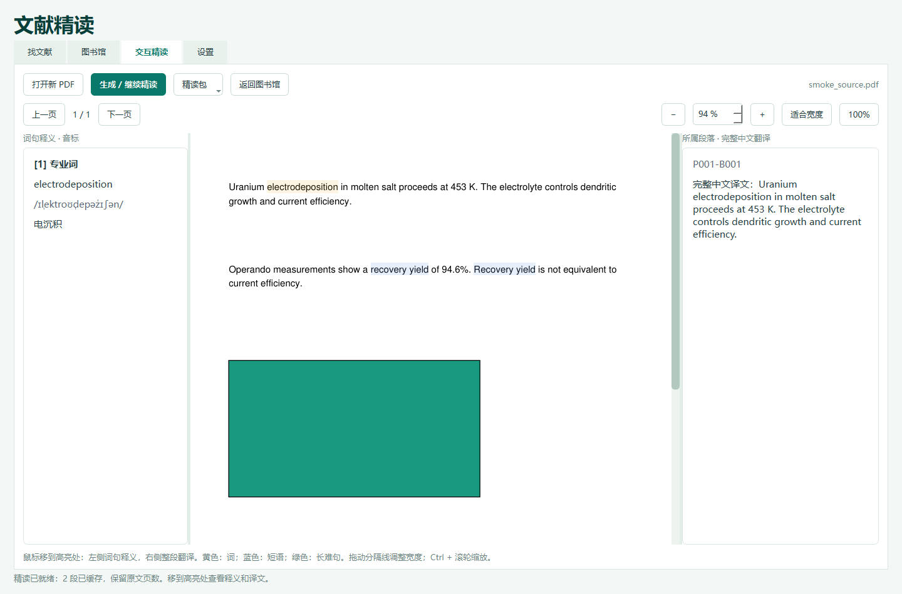

# 文献精读 · MoltenDaily 1.4.1

Windows 原生 EXE，固定浅色 / 深绿色。按“找文献 → 图书馆 → 交互精读”组织操作，全局 API 与额度位于设置。

## 使用

1. 解压 Windows x64 便携包，运行 MoltenDaily.exe，无需安装 Python。
2. 在设置选择供应商、填写 API Key 并检测模型；只阅读已有精读包时不需要密钥。
3. 找文献页设置方向和 JIF 门槛，查询后 Ctrl / Shift 多选，点击“加入图书馆”。搜索结果不会自动入库；已有图书馆不受更换条件影响。入库后可获取或关联 PDF、分类管理。也可直接在图书馆导入自己的 PDF。
4. 阅读 PDF → 生成 / 继续精读。中间保留原版 PDF、原图和公式，页数不增加。
5. 鼠标移到高亮处，左侧自动显示词句释义与已有音标，右侧显示所属段落完整译文。黄色为专业词、蓝色为短语、绿色为长难句；进入两侧阅读时保留最后选中的内容。也可悬停普通段落查看译文。
6. Ctrl + 滚轮或工具栏缩放；拖动两侧分隔线调整阅读宽度。预览位图上限 800 万像素，较高倍数放大已有位图，原 PDF 不被改写。

逐段保存付费响应，暂停、重启、更换模型后继续使用缓存。暂停后已经完成的段落仍可阅读。默认每日基础额度 100 万 Token；不足时询问是否仅为当天追加额度，拒绝则保留进度并暂停。

## 精读包：像字幕一样分享

在交互精读页点击 **精读包 → 导出精读包**，生成 `.mdstudy` 文件，包含原文段落、高亮坐标、中文译文、词句释义和音标。支持分享部分完成的进度。

对方使用本软件 1.4.0 或兼容版本，点击 **精读包 → 导入精读包**。图书馆存在同一份 PDF 时立即匹配并打开；也可以先导入包，之后打开对应 PDF 自动套用。相同内容的 PDF 改文件名也能识别。

匹配依据为整个 PDF 的 SHA-256，PDF 内容必须完全相同。重新保存、添加水印或换版可能改变指纹，这时不会强行套用，以免批注错位。共享文件不包含 PDF 本身、API 密钥、电脑路径、个人设置或图书馆笔记，需要另行提供或已有对应 PDF。对方无需 API 密钥即可阅读全部已完成内容；仅补译缺失段落才需要 API。

重复导入按段落补齐，接收方已有的段落优先保留。包是受大小限制的 ZIP + JSON 数据格式，不执行脚本，不解压任意路径。精读包内容来自分享者，格式校验并不等于对译文科学准确性的独立核实。

## 删除与恢复

图书馆支持 Ctrl / Shift 多选，点击 **删除选中** 后确认，单篇与批量操作一致。文献移入 **回收站**，从正常列表和检索结果隐藏，PDF、笔记、分类关系及翻译缓存保留。在回收站选中文献点击 **恢复选中** 即可恢复。重新检索不会自动恢复删除记录；主动重新导入同一份 PDF 会恢复已有记录，避免重复建库。



## 搜索与限制

- 找文献只展示当前条件下本次取得、通过主题及 JIF 筛选的结果。更改方向、检索词、日期、年份、JIF、页数或检索深度后旧列表立即隐藏；保存的文献始终留在图书馆。
- 结果独立缓存，点击 **加入图书馆** 才入库，支持 Ctrl / Shift 多选；已入库不重复添加。未入库结果可查看出版社；入库后再获取 PDF、关联附件或分类。新版不会自行清理过去已保存的文献。
- Crossref / OpenAlex 支持游标分页，默认每来源每组词 3 页、每页 100 条，高级选项可调至 10 页。取消前 20 篇 AI 评估和按需结果 3 篇上限。大范围查询可能耗时及消耗更多 Token。
- 当常规结果有至少 100 条而达标期刊题录不足 10 条，已配置 API 时从已核实、超过门槛的期刊名单内选最多 3 本相关期刊补充检索，再逐篇核验，不由 AI 生成 DOI 或 JIF。
- 配置 API 后，主题通过要求核心内容匹配、评分至少 75，且提供可在题目 / 摘要中核对的连续原文证据。背景提及、缺少证据、模型失败或待评估均不放行。未配置 API 时采用保守关键词匹配，不能等同于完整语义审核。
- JIF 默认 **最新已核实**，逐期刊取已核实的最新年份，结果明确显示各自年份；也可选择特定年份，绝不跨年替代。内置 102 本期刊、114 条 2023–2025 年指标，计算机视觉方向补充 TPAMI、Artificial Intelligence Review、IJCV。各年份覆盖不同，并非全量 JCR 数据；JIF 年份不等于论文发表年份。
- 来源包括 [Nature Portfolio 公开指标表](https://www.nature.com/nature-portfolio/about-journals/journal-metrics)、[ACS Energy Letters 指标社论](https://pubs.acs.org/doi/10.1021/acsenergylett.5c01964)、[Springer IJCV](https://link.springer.com/journal/11263)、[Springer AIR](https://link.springer.com/journal/10462) 和 [IEEE Computer Society](https://www.computer.org/publications)。联网更新按钮目前同步 Nature Portfolio 的明确标年 JIF 表，保留已有同年人工记录；其他期刊可导入有年份、来源、核验日期的 CSV。不得将五年 JIF 或 CiteScore 当作普通 JIF。
- 缺失、年份不符、数值不超过阈值或同一期刊同年存在冲突的指标一律排除。界面给出 JIF 未核实、未达标、主题剔除、待核验的数量；会议论文没有期刊 JIF，不能凭会议声誉自动放行。
- 本版需要有文本层的 PDF，扫描件 OCR 不支持。图内文字和复杂公式保留原文；不能声称 AI 译文和音标零误差。
- 原文块对应不等于逐行排版一致。长块拆分后仍保留来源编号；参考文献等元数据可保持原文形式。
- 密钥用 Windows DPAPI 加密，本地保存；受限环境可能使用本机绑定。不要分享 userdata。API 会收到待处理原文文字，密钥不会加入 PDF 或公开源码。

## 题录文件导出

图书馆支持导出 RIS 和 EndNote Tagged（ENW）：选择一篇导出单篇，Ctrl / Shift 多选后批量导出，未选中时导出当前分类中可见的全部文献。文件可导入 EndNote、Zotero 等引用管理器。导出只保存文件，不打开外部软件，也不修改 Word 文档。

保留完整作者、卷期、页码 / 文章号和 DOI；缺失字段写入备注，不由模型补造。附件使用本机路径，不自动打包 PDF；另支持导入既有 RIS / EndNote XML。

## 供应商与模型

- 提供 DeepSeek 官方、硅基流动和自定义兼容接口。自定义接口需支持 GET /models 和 POST /chat/completions。
- 首次填写密钥后、切换到已配置供应商后、进入设置时自动查询模型。点击“检测 / 刷新可用模型”可重新获取新发布的模型。
- 模型列表来自服务端，不是写死在软件中的白名单。列表可见不等于每个模型都支持文本对话和 JSON 输出；仍需选用具有相应能力与权限的模型。
- 密钥与选择的模型按完整 API 地址分别保存；修改地址不会把旧地址的密钥带给新地址。失败时保留手动输入模型 ID 的入口。

## 性能与验证

1.4.0 的正常阅读流程不再生成重复原页的左右留白 PDF。13 页真实论文的 214 段缓存直接用于 13 页交互阅读，精读包约 182 KB；另一资料库导入后新增 Token 为零。共检查 5,328 个高亮矩形，支持旋转页面和 25%–400% 缩放；对应缓存原文件未被修改。

窗口缩放合并为一次重绘，相同页面与倍率不重复栅格化；只提取文字时不解码嵌入图像；单条题录直接查询数据库。翻译仍在独立进程运行，保留暂停与预算控制。

1.4.1 共 98 项自动测试通过，保留原有阅读、分享、回收站与引用导出验证，并新增检索条件隔离、分页、主题证据、年份、期刊补充检索及手动批量入库测试。真实计算机视觉检索取得 259 条题录，69 条通过 JIF 后核对主题，16 条通过、53 条剔除；另有 190 条未核实 JIF 而被排除。这是限定检索词与深度下的样本结果，不代表穷尽检索或 AI 零误差。详见 QA_1.4.1.md。

## 构建

Windows x64、Python 3.12：

```powershell
./build.ps1 -Test
```

或安装 requirements-lock.txt 后使用 PyInstaller 打包 app.py。`--data-dir PATH` 可指定资料目录。`--smoke PATH --data-dir ISOLATED_PATH` 使用本地模拟响应检查四页界面、交互精读、共享包、缩放和 DPAPI；不调用付费 API。

## 许可证

应用为 AGPL-3.0-or-later，详见 LICENSE.txt 和 THIRD_PARTY_NOTICES.md。论文版权不因使用本软件而改变。发行包提供完整源码、依赖锁定表及第三方许可证。
